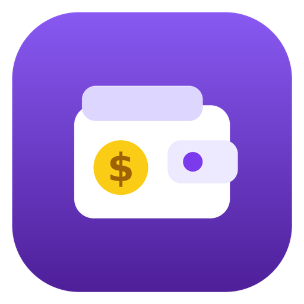

# Minhas Finanças

App Android de controle financeiro pessoal. Funciona offline e guarda tudo só no celular.

## 📲 Baixar o APK

**[⬇ Baixar a versão mais recente](https://github.com/VictorLanes/financas-app/releases/latest/download/MinhasFinancas.apk)**

Cada `push` na `main` gera um APK novo em **Releases**, que instala por cima do anterior sem perder os dados.

## 💻 Versão para computador + sincronização

- O mesmo app roda no navegador: o arquivo `index.html` (anexado em cada Release, ou gerado com `npm run build:web` em `dist-web/`) é o site completo num arquivo só. Basta publicar no Netlify.
- **Banco de dados grátis no Google Planilhas**: o script `google-apps-script/Code.gs` guarda os dados numa planilha sua. Celular e computador sincronizam com ela automaticamente (ao abrir, ao voltar para o app, após cada alteração e a cada minuto no computador). Funciona offline: as alterações são juntadas item por item quando a internet volta.
- Configuração: veja as instruções no topo do `Code.gs`. Depois, em cada aparelho: **Mais > Ajustes > Conectar planilha do Google**. No segundo aparelho, use o código **MF1:** copiado do primeiro.

## Funcionalidades

- **Início**: saldo atual, previsão para o fim do mês, receitas × despesas, contas vencidas, próximos vencimentos, gráfico por categoria, últimos 6 meses, orçamentos e cartões
- **Análise do mês**: quanto dá para gastar por dia (e por semana) até o fim do mês, previsão de despesas e do resultado, saldo previsto, média diária, comparação com o mesmo período do mês passado, média dos últimos 3 meses, gráfico de gasto acumulado, maiores despesas, dia da semana em que mais gasta, alertas e meta de economia mensal
- **Receitas e Despesas**: toque no card de Receitas ou Despesas para ver a lista do mês (com filtro por categoria). Tocar num item abre os detalhes, com ✏️ para editar e ✖ vermelho para excluir
- **Vale Refeição / Alimentação**: saldo recebido no mês e gastos separados do saldo das contas, com saldo disponível, quanto gastar por dia, previsão, gastos por categoria e relatório
- **Lançamentos**: despesas, receitas e transferências, com filtros por mês, tipo, pendentes, cartão e busca
  - Parcelado (divide o valor) ou repetir todo mês (mesmo valor)
  - Marcar como pago ou pendente, observação e código de barras/PIX para copiar depois
- **Contas a pagar e a receber**: boletos, faturas e parcelas de empréstimos, agrupados em vencidas, hoje, 7 dias, este mês e próximos meses, com botão **Pagar/Receber**
- **Cartões de crédito**: limite e disponível, fechamento e vencimento, faturas por mês (aberta/fechada/vencida/paga), compras parceladas caindo uma em cada fatura, pagar e desfazer pagamento
- **Empréstimos**: o que peguei ou o que emprestei, com valor da parcela informado (o app calcula a taxa) ou juros Price/SAC/sem juros
- **Financiamentos**: valor do bem, entrada, tabela de amortização (juros, amortização e saldo devedor), parcelas já pagas antes do app
- **Orçamentos** por categoria, com alerta visual ao passar de 80% e de 100%
- **Metas** (caixinhas): guardar e retirar, com ou sem movimentar uma conta
- **Contas e carteiras**, transferência entre elas e ajuste de saldo
- **Categorias** personalizáveis (ícone e cor)
- **Relatórios em PDF e Excel** de cada aba: resumo do mês, extrato, resumo do ano, contas, cartões, empréstimos, financiamentos, orçamentos, metas e saldos. O Excel vem formatado com tabelas, totais e valores em R$.
- **Notificações de vencimento**: X dias antes e no dia, no horário escolhido, agrupando as contas do mesmo dia
- **Widgets**: *Saldo* (saldo + receitas/despesas do mês), *Próximos vencimentos* (lista) e *Lançar rápido* (1×1)
- **Tela de bloqueio** com PIN (4 ou 6 dígitos) ou desenho, relógio, resposta imediata ao toque e bloqueio configurável ao sair do app;, ocultar valores (no app e nos widgets), tema claro/escuro, backup e restauração

## Tecnologia

JavaScript puro (`src/`) empacotado com esbuild; Capacitor 8 (Android); jsPDF + autoTable (PDF); ExcelJS (Excel); widgets nativos em Java (`android/app/src/main/java/.../widget`).
